# 🛸 ANTIGRAVITY-SKILL-SUPREME

<div align="center">

[](https://opensource.org/licenses/MIT)
[](https://deepmind.google)
[](#-catálogo-completo-de-skills)
[](#-regras-mestras-de-sistema)
[](#-servidores-mcp-model-context-protocol)
[](CONTRIBUTING.md)

**O Framework Supremo de Engenharia, Regras Mestras, Skills de Produção e Toolchain Automatizada para o Google Antigravity e Agentes Autônomos de IA.**

[English Version (README_EN.md)](README_EN.md) • [Começo Rápido](#-começo-rápido-em-1-minuto) • [Catálogo de Skills](#-catálogo-completo-de-skills) • [Regras Mestras](#-regras-mestras-de-sistema) • [Servidores MCP](#-servidores-mcp-model-context-protocol) • [Toolchain](#-toolchain-e-programas-essenciais)

---

### ⭐ Se este projeto revolucionou o seu fluxo com agentes de IA, deixe uma estrela no topo! Sua estrela ajuda a comunidade open-source a crescer.

</div>

---

## 📖 O que é o ANTIGRAVITY-SKILL-SUPREME?

O **ANTIGRAVITY-SKILL-SUPREME** é o primeiro pacote definitivo *open-source* que transforma agentes de inteligência artificial em **Engenheiros de Software Sênior, Arquitetos de Soluções e Auditores DevSecOps**.

Chega de *vibe coding* frágil, alucinações de código sem testes, loops infinitos de agentes e quebras em produção. Este repositório consolida:

1. **40+ Skills Especializadas:** Cobrindo todo o ciclo de vida do software (*Spec -> Plan -> Build -> Test -> Review -> Ship*), design de interface moderna, diagnóstico de sessões e governança de Segundo Cérebro (Wiki Karpathy).
2. **7 Regras Mestras de Sistema:** Instruções inegociáveis de postura crítica (*Anti-Yes-Man*), limites de correção (*Pare no 3º Patch*), Quality Gates de 4 eixos, os 7 Pilares Defensivos de DevSecOps e o **Ambiente Fechado (Claude Code + Antigravity com `ai-memory` + `DOCUMENTACOES/` por projeto)**.
3. **Esquadrão de Subagentes:** Perfis otimizados de agentes de pesquisa, revisão sênior, auditoria de segurança e performance web.
4. **Servidores MCP Pré-Configurados:** Integrações com **`ai-memory`** (memória operacional unificada Claude Code $\longleftrightarrow$ Antigravity), Google Stitch, GitHub, NotebookLM e Chrome DevTools.
5. **Toolchain Automatizada:** Script PowerShell de 1 clique para instalar runtimes (Node, Bun, Python uv), Docker, Ollama, Obsidian, FFmpeg e ferramentas CLI.

---

## 🏛️ Arquitetura do Sistema

```mermaid
graph TD
    Dev(["👤 Desenvolvedor"]) <--> Core["🚀 Google Antigravity + Claude Code"]
    
    subgraph Governance ["1. Governança & Inteligência"]
        Core --> Rules["📜 7 Regras Mestras (Quality Gate / Anti-Yes-Man / DevSecOps / Ambiente Fechado)"]
        Core --> Skills["⚡ 40+ Skills de Engenharia & Customizadas"]
        Core --> Router["🔀 Orquestrador de Subagentes, DOCUMENTACOES/ & Ledger"]
    end
    
    subgraph Squad ["2. Esquadrão Especializado (Subagentes)"]
        Router --> S_Self["👤 self (Executor Pleno)"]
        Router --> S_Research["🔎 research (Pesquisa / Docs)"]
        Router --> S_Reviewer["🧐 code-reviewer (Qualidade / AST)"]
        Router --> S_Sec["🛡️ security-auditor (DevSecOps)"]
        Router --> S_QA["🧪 test-engineer (TDD / Testes)"]
        Router --> S_Perf["⚡ web-perf-auditor (Web Vitals)"]
    end
    
    subgraph MCP_Integrations ["3. Camada MCP (Model Context Protocol)"]
        Router --> MCP_AIM["🧠 ai-memory MCP (Memória Unificada :49374)"]
        Router --> MCP_Stitch["🎨 StitchMCP (UI Design System)"]
        Router --> MCP_GH["🐙 GitHub MCP (PRs / Issues / Commits)"]
        Router --> MCP_NLM["🎙️ NotebookLM MCP (Base de Conhecimento)"]
        Router --> MCP_CDT["🌐 Chrome DevTools MCP (Browser Real)"]
    end
    
    subgraph System_Toolchain ["4. Toolchain & Infraestrutura Local"]
        Core --> Runtimes["Node.js / Bun / Python uv"]
        Core --> Containers["Docker (Postgres / Redis / n8n)"]
        Core --> OfflineAI["Ollama Local (:11434)"]
        Core --> SecondBrain["Obsidian (Wiki Karpathy)"]
    end
```



---

## ⚡ Começo Rápido em 1 Minuto

### 1. Clonar o Repositório
```bash
git clone https://github.com/tsthas/ANTIGRAVITY-SKILL-SUPREME.git
cd ANTIGRAVITY-SKILL-SUPREME
```

### 2. Provisionar Toda a Toolchain (Windows)
Abra o PowerShell como Administrador e execute:
```powershell
Set-ExecutionPolicy Bypass -Scope Process -Force
.\toolchain\setup_windows.ps1
```
*O script instalará automaticamente: Git, GitHub CLI, Node.js LTS, Python, Astral uv, Bun, VS Code, Obsidian, FFmpeg, Ollama e Docker Desktop.*

### 3. Ativar as Skills no seu Antigravity
Copie as pastas de skills para a sua configuração do Antigravity:
```powershell
# Copiar skills customizadas e de engenharia para o diretório de skills global:
Copy-Item -Path ".\skills\custom\*" -Destination "$env:USERPROFILE\.gemini\config\skills\" -Recurse -Force
Copy-Item -Path ".\skills\engineering\*" -Destination "$env:USERPROFILE\.gemini\config\skills\" -Recurse -Force
```

### 4. Configurar Servidores MCP
```powershell
Copy-Item -Path ".\mcp\mcp_config.template.json" -Destination "$env:USERPROFILE\.gemini\config\mcp_config.json"
```
*Abra o arquivo gerado e insira seu token do GitHub e chaves de API desejadas.*

---

## 🎯 Comparativo: Sem vs. Com Antigravity Supreme

| Dimensão | Vibe Coding Comum | Com Antigravity Supreme |
| :--- | :--- | :--- |
| **Postura do Agente** | *Yes-Man* (aceita tudo e gera código às cegas) | **Anti-Yes-Man Socrático** (questiona premissas e propõe trade-offs) |
| **Ciclo de Desenvolvimento** | Gera arquivos gigantes de uma só vez sem testes | **SDD + TDD** em fatias atômicas + `python verificar.py` (código 0) |
| **Erros e Bugs** | Tenta dezenas de correções aleatórias em loop | **Heurística do 3º Patch** (para e diagnostica arquitetura) |
| **Segurança** | Expõe senhas no código, ignora RLS e autorização | **7 Pilares DevSecOps** obrigatórios (OWASP, RLS, DTOs Zod, `gitleaks`) |
| **Memória & Documentação** | Perde o contexto ao longo de conversas extensas | **Dupla Camada:** **`ai-memory`** (handoff Claude $\leftrightarrow$ Antigravity) + **`DOCUMENTACOES/`** integral por projeto |
| **Revisão de Código** | Nenhuma revisão pré-merge | **Quality Gate de 4 Eixos** executado por subagente revisor |

---

## 📚 Catálogo Completo de Skills

O repositório contém **40 skills homologadas** organizadas em 3 pilares:

### 🌟 1. Skills Customizadas & Autorais (`skills/custom/`)
* **`vibe-architect`**: Framework socrático de arquitetura, divisão em ondas paralelas, controle por ledger em disco e circuit breaker de 5 rodadas.
* **`wiki-karpathy`**: Sistema de governança do Segundo Cérebro (Karpathy Wiki) para Obsidian, convertendo `RAW/` em notas atômicas interligadas por wikilinks `[[...]]`.
* **`looping`**: Protocolo autônomo para processamento iterativo e ingestão em lote contínuo de filas de documentos.
* **`diagnostico-sessao`**: Auditoria forense de sessões do Antigravity inspecionando `transcript.jsonl` com citações obrigatórias de linha e causa-raiz.
* **`frontend-design`**: Diretrizes de UI/UX de alta fidelidade para Web e Mobile (Expo/React Native), eliminando o visual genérico de IA com tokens semânticos e micro-interações.
* **`git-worktrees`**: Isolamento de tarefas e desenvolvimento profissional através de Git Worktrees no Windows/PowerShell com baseline de testes limpos.

### ⚙️ 2. Skills de Engenharia de Software (`skills/engineering/`)
Desenvolvidas pela liderança técnica de engenharia (Addy Osmani):
* **`spec-driven-development`**: Elaboração de PRDs e contratos antes da codificação.
* **`test-driven-development`**: Aplicação rigorosa do ciclo Red-Green-Refactor.
* **`code-review-and-quality`**: Auditoria sênior pré-merge sob 5 eixos técnicos.
* **`security-and-hardening`**: Proteção ativa contra o OWASP Top 10 e sanitização estrita.
* **`code-simplification`**: Refatoração pragmática e respeito à Cerca de Chesterton.
* **`api-and-interface-design`**: Criação de contratos estáveis REST, GraphQL e Zod.
* **`browser-testing-with-devtools`**: Validação em navegador real via Chrome DevTools.
* **`ci-cd-and-automation`**: Automação de pipelines de CI/CD e esteiras de qualidade.
* **`constraint-driven-development`**: Contrato escrito de qualidade via `CONSTRAINTS.md`.
* **`context-engineering`**: Otimização cirúrgica da alocação de tokens e regras de agente.
* **`debugging-and-error-recovery`**: Investigação metódica de causa-raiz.
* **`deprecation-and-migration`**: Migrações sem downtime com padrão expand/contract.
* **`documentation-and-adrs`**: Registro histórico de decisões de arquitetura (ADRs).
* **`doubt-driven-development`**: Revisão adversarial de premissas arriscadas.
* **`frontend-ui-engineering`**: Interfaces acessíveis (WCAG AA) e de alta usabilidade.
* **`git-workflow-and-versioning`**: Commits atômicos e versionamento semântico.
* **`idea-refine`**: Refinamento de ideias embrionárias por divergência e convergência.
* **`incremental-implementation`**: Entrega fatiada em fatias finas (*thin slices*).
* **`interview-me`**: Sabatina de clarificação (uma pergunta por vez até 95% de certeza).
* **`observability-and-instrumentation`**: Tracing, métricas e logs estruturados.
* **`performance-optimization`**: Otimização de tempos de resposta e consultas SQL.
* **`planning-and-task-breakdown`**: Decomposição estruturada de cronogramas técnicos.
* **`shipping-and-launch`**: Checklist de pré-deploy, lançamento gradual e rollbacks.
* **`source-driven-development`**: Fundamentação estrita na documentação oficial.
* **`using-agent-skills`**: Meta-skill de orquestração e descoberta dinâmica.

### 📦 3. Skills Nativas do Antigravity (`skills/builtin/`)
* **`antigravity_guide`**, **`agy-customizations`**, **`generative_ui`**, **`migrate-workflows`**, **`plugin`**, **`automation`**, **`permissioned-github`**, **`ui-extension`**, **`ui-plugin-navigation`**.

---

## 📜 Regras Mestras de Sistema

Localizadas em `rules/`, estas diretrizes operam como constituição para os agentes:

1. [**`01_regra_mestra_antigravity.md`**](rules/01_regra_mestra_antigravity.md):
   * Postura Anti-Yes-Man, economia de tokens, memória integrada (`ai-memory`) + manutenção integral de `DOCUMENTACOES/` por projeto, SDD+TDD e os **7 Pilares DevSecOps**.
2. [**`02_protocolo_vibe_architect.md`**](rules/02_protocolo_vibe_architect.md):
   * Proibição de código prematuro, ondas paralelas, Ledger persistente e a **Heurística do 3º Patch**.
3. [**`03_protocolo_verificacao_final.md`**](rules/03_protocolo_verificacao_final.md):
   * Quality Gate de 4 eixos ativado pelos comandos `/verificar`, `/review` ou *"faz a verificação final"*.
4. [**`04_governanca_wiki_karpathy.md`**](rules/04_governanca_wiki_karpathy.md):
   * Padrões da estrutura `RAW/` -> `WIKI/`, templates atômicos e interconexão de conceitos.
5. [**`05_gestao_portas_e_infraestrutura.md`**](rules/05_gestao_portas_e_infraestrutura.md):
   * Política padrão de faixas de portas de rede (APIs `8000s`, Web `3000s`, Dashboards `5173s`, `ai-memory` `49374`).
6. [**`06_dicionario_de_termos_confluence.md`**](rules/06_dicionario_de_termos_confluence.md):
   * Padrão obrigatório de glossário para documentações corporativas e Atlassian Confluence.
7. [**`07_ambiente_fechado_e_ai_memory.md`**](rules/07_ambiente_fechado_e_ai_memory.md):
   * Protocolo do Ambiente Fechado (Claude Code Piloto + Antigravity Copiloto), handoffs via MCP `ai-memory`, preservação integral de `DOCUMENTACOES/` em cada projeto e verificação obrigatória com `python verificar.py`.

---

## 🔌 Servidores MCP (Model Context Protocol)

Prontos para conexão através do arquivo `mcp/mcp_config.template.json`:

* **🧠 ai-memory MCP:** Memória operacional local unificada (`127.0.0.1:49374`) e adaptador de handoffs (`mcp/ai_memory_antigravity.py`) entre Claude Code e Google Antigravity.
* **🎨 StitchMCP:** Geração visual de telas de interface e design systems via Google Stitch.
* **🐙 GitHub MCP:** Criação de pull requests, revisão de código e gestão de issues no GitHub.
* **🎙️ NotebookLM MCP:** Ingestão de fontes, consultas semânticas e síntese de áudio.
* **🌐 Chrome DevTools MCP:** Inspeção do DOM, console e performance em navegadores reais.

---

## 🛠️ Toolchain e Programas Essenciais

A stack foi selecionada para garantir o menor tempo de ciclo e máxima confiabilidade:

| Ferramenta | Papel na Engenharia | Como Instalar |
| :--- | :--- | :--- |
| **Node.js LTS & npm/npx** | Ecossistema JavaScript & MCPs | `winget install OpenJS.NodeJS.LTS` |
| **Bun** | Testes e scripts TypeScript ultrarrápidos | `irm https://bun.sh/install.ps1 \| iex` |
| **Python 3.12+ & uv** | Automações, IA e Scrapers em velocidade máxima | `irm https://astral.sh/uv/install.ps1 \| iex` |
| **Git & GitHub CLI (`gh`)** | Controle de versão e automação de PRs | `winget install Git.Git GitHub.cli` |
| **Obsidian** | Visualização de conhecimento em grafo | `winget install Obsidian.Obsidian` |
| **Docker Desktop** | Bancos de dados locais (Postgres, Redis) e contêineres | `winget install Docker.DockerDesktop` |
| **Ollama** | Modelos LLM locais offline (porta 11434) | `winget install Ollama.Ollama` |
| **FFmpeg** | Processamento programático de áudio e vídeo | `winget install Gyan.FFmpeg` |

*Tudo isso é instalado com 1 clique pelo nosso script [`toolchain/setup_windows.ps1`](toolchain/setup_windows.ps1).*

---

## ⚡ Comandos de Barra (Slash Commands)

Agilize o seu trabalho diário com atalhos de alto nível:

* **`/spec`**: Cria a especificação completa de requisitos (PRD).
* **`/plan`**: Fatia o projeto em tickets atômicos e ondas paralelas.
* **`/build auto`**: Implementa o plano aprovado autonomamente com testes.
* **`/test`**: Roda e valida a suíte de testes do projeto.
* **`/review`** ou **`/verificar`**: Dispara a auditoria final de 4 eixos (Quality Gate).
* **`/code-simplify`**: Refatora o código eliminando complexidade acidental.
* **`/grill-me`**: Inicia a sabatina socrática para eliminar ambiguidades.
* **`/ingerir`**: Processa um documento bruto de `RAW/` para a `WIKI/` do Obsidian.
* **`/looping`**: Ingestão contínua em lote até esvaziar a pasta de entrada.

---

## 📖 Dicionário de Termos (Glossário)

| Termo / Sigla | Definição Clara e Acessível |
| :--- | :--- |
| **ai-memory** | Servidor MCP local (`127.0.0.1:49374`) que unifica a memória operacional e os handoffs de sessão entre Claude Code e Google Antigravity. |
| **Antigravity** | Plataforma de desenvolvimento de software agêntico da Google para engenharia assistida por IA. |
| **Circuit Breaker** | Mecanismo de segurança que limita o bate-rebate entre subagentes a no máximo 5 rodadas. |
| **DTO (Data Transfer Object)** | Objeto tipado utilizado para serializar e validar dados em trânsito, protegendo o banco de dados. |
| **DoD (Definition of Done)** | Critério observável e mensurável (`python verificar.py` com código 0) que comprova que uma tarefa foi concluída com sucesso real. |
| **Ledger Persistente** | Registro imutável em disco que preserva o estado das tarefas mesmo após compactações de contexto. |
| **MCP (Model Context Protocol)** | Protocolo aberto que padroniza o acesso de modelos de IA a ferramentas e dados externos. |
| **Ondas Paralelas** | Estratégia de fatiamento onde tarefas simultâneas nunca editam os mesmos arquivos. |
| **Pare no 3º Patch** | Heurística que interrompe tentativas de correção após 3 falhas para diagnosticar defeito de arquitetura. |
| **RLS (Row Level Security)** | Política de banco de dados PostgreSQL que restringe acesso a nível de linha para cada usuário. |
| **SDD (Spec-Driven Development)** | Metodologia que prioriza a especificação completa de contratos antes do código de produção. |
| **TDD (Test-Driven Development)** | Prática onde testes que falham (*Red*) são escritos antes do código que passa (*Green*). |

---

## 🤝 Como Contribuir

Contribuições são muito bem-vindas! Se você tem uma nova skill, melhoria de regras ou integração MCP:
1. Veja nossas diretrizes em [`CONTRIBUTING.md`](CONTRIBUTING.md).
2. Abra um Pull Request ou reporte melhorias nas Issues.

---

## 📄 Licença

Distribuído sob a licença **MIT**. Gratuito e livre para uso pessoal, comercial e educacional. Consulte [`LICENSE`](LICENSE) para mais detalhes.

---

<div align="center">

**Feito com determinação pela comunidade de engenharia do Google Antigravity.**  
⭐ **Gostou do projeto? Não esqueça de deixar a sua estrela no repositório!** ⭐

</div>
