# 🛸 ANTIGRAVITY-SKILL-SUPREME

<div align="center">

[](https://opensource.org/licenses/MIT)
[](https://deepmind.google)
[](#-full-skills-catalog)
[](#-master-system-rules)
[](#-model-context-protocol-mcp-servers)
[](CONTRIBUTING.md)

**The Ultimate Production Engineering Framework, Master System Rules, 40+ Production Skills, and Automated Toolchain for Google Antigravity & AI Coding Agents.**

[Versão em Português (README.md)](README.md) • [1-Minute Quickstart](#-1-minute-quickstart) • [Skills Catalog](#-full-skills-catalog) • [Master Rules](#-master-system-rules) • [MCP Servers](#-model-context-protocol-mcp-servers) • [Toolchain](#-essential-toolchain--software)

---

### ⭐ If this project saves you hours and elevates your AI agent workflows, please leave a star on GitHub! It means the world to open-source maintainers.

</div>

---

## 📖 What is ANTIGRAVITY-SKILL-SUPREME?

**ANTIGRAVITY-SKILL-SUPREME** is the first comprehensive open-source framework designed to elevate autonomous AI coding agents into **Staff/Principal Software Engineers, Solution Architects, and DevSecOps Auditors**.

No more fragile "vibe coding", untested code hallucinations, runaway agent loops, or production breakages. This repository packages:

1. **40+ Production Skills:** Spanning the entire software engineering lifecycle (*Spec -> Plan -> Build -> Test -> Review -> Ship*), high-end mobile/web UI design, session forensics, and Obsidian Second Brain governance (Karpathy Wiki).
2. **6 Master System Rules:** Rigorous non-negotiable guidelines covering Anti-Yes-Man posture, "Stop on 3rd Patch" heuristic, 4-Axis Quality Gates, and the 7 Defensive DevSecOps Pillars.
3. **Specialized Subagent Squad:** Pre-configured roles for deep research, senior code review, threat modeling, QA engineering, and web performance audits.
4. **Pre-configured MCP Servers:** Native connectors for Google Stitch, GitHub, Google NotebookLM, and Chrome DevTools.
5. **Automated Toolchain Provisioning:** 1-click Windows PowerShell installer (`setup_windows.ps1`) for Node.js, Bun, Python uv, Docker, Ollama, Obsidian, FFmpeg, and CLI tools.

---

## 🏛️ System Architecture

```mermaid
graph TD
    Dev(["👤 Developer / Architect"]) <--> Core["🚀 Google Antigravity Core"]
    
    subgraph Governance ["1. Intelligence & Governance Layer"]
        Core --> Rules["📜 6 Master Rules (Quality Gate / Anti-Yes-Man / DevSecOps)"]
        Core --> Skills["⚡ 40+ Production & Custom Skills"]
        Core --> Router["🔀 Subagent Router & Persistent Disk Ledger"]
    end
    
    subgraph Squad ["2. Specialized Multi-Agent Squad"]
        Router --> S_Self["👤 self (Full Executor)"]
        Router --> S_Research["🔎 research (Web / Docs Scraper)"]
        Router --> S_Reviewer["🧐 code-reviewer (Senior AST Review)"]
        Router --> S_Sec["🛡️ security-auditor (DevSecOps / OWASP)"]
        Router --> S_QA["🧪 test-engineer (TDD / Test Suites)"]
        Router --> S_Perf["⚡ web-perf-auditor (Core Web Vitals)"]
    end
    
    subgraph MCP_Integrations ["3. MCP Integration Layer"]
        Router --> MCP_Stitch["🎨 StitchMCP (UI / Design System)"]
        Router --> MCP_GH["🐙 GitHub MCP (PRs / Issues / Commits)"]
        Router --> MCP_NLM["🎙️ NotebookLM MCP (Knowledge Graph)"]
        Router --> MCP_CDT["🌐 Chrome DevTools MCP (Real Browser)"]
    end
    
    subgraph System_Toolchain ["4. Local Infrastructure & Toolchain"]
        Core --> Runtimes["Node.js / Bun / Python uv"]
        Core --> Containers["Docker (Postgres / Redis / n8n)"]
        Core --> OfflineAI["Ollama Local (:11434)"]
        Core --> SecondBrain["Obsidian (Karpathy Wiki)"]
    end
```



---

## ⚡ 1-Minute Quickstart

### 1. Clone the Repository
```bash
git clone https://github.com/tsthas/ANTIGRAVITY-SKILL-SUPREME.git
cd ANTIGRAVITY-SKILL-SUPREME
```

### 2. Provision the Whole Toolchain (Windows)
Run PowerShell as Administrator:
```powershell
Set-ExecutionPolicy Bypass -Scope Process -Force
.\toolchain\setup_windows.ps1
```
*Installs Git, GitHub CLI, Node.js LTS, Python, Astral uv, Bun, VS Code, Obsidian, FFmpeg, Ollama, and Docker Desktop automatically.*

### 3. Copy Skills to Your Antigravity Configuration
```powershell
Copy-Item -Path ".\skills\custom\*" -Destination "$env:USERPROFILE\.gemini\config\skills\" -Recurse -Force
Copy-Item -Path ".\skills\engineering\*" -Destination "$env:USERPROFILE\.gemini\config\skills\" -Recurse -Force
```

### 4. Setup MCP Servers
```powershell
Copy-Item -Path ".\mcp\mcp_config.template.json" -Destination "$env:USERPROFILE\.gemini\config\mcp_config.json"
```

---

## 🎯 Head-to-Head Comparison

| Dimension | Regular "Vibe Coding" | With Antigravity Supreme |
| :--- | :--- | :--- |
| **Agent Posture** | *Yes-Man* (accepts flawed premises, codes blindly) | **Socratic Anti-Yes-Man** (challenges assumptions, offers trade-offs) |
| **Development Lifecycle** | Giant unverified single-shot files | **SDD + TDD** with atomic tasks across parallel waves |
| **Bug Fixing** | Infinite randomized retry loops | **Stop on 3rd Patch Heuristic** (halts to diagnose architecture) |
| **Security** | Hardcoded secrets, missing RLS, open endpoints | **7 DevSecOps Pillars** (OWASP, RLS, Zod/Pydantic DTOs) |
| **Long-Horizon Memory** | Loses thread after context compaction | **Persistent Disk Ledger** (`LEDGER_[PROJECT].md`) survives resets |
| **Review Standard** | No review before merge | **4-Axis Quality Gate** evaluated by senior reviewer agent |

---

## 📚 Full Skills Catalog

### 🌟 1. Custom & Proprietary Skills (`skills/custom/`)
* **`vibe-architect`**: Socratic framework for intent clarification, parallel wave decomposition, disk ledger governance, and 5-round circuit breaker.
* **`wiki-karpathy`**: Second Brain governance for Obsidian (Karpathy Wiki), transforming raw notes into atomic concepts connected by `[[wikilinks]]`.
* **`looping`**: Autonomous iterative batch processor for continuous document queues.
* **`diagnostico-sessao`**: Forensic audit of Antigravity sessions parsing `transcript.jsonl` with cited line evidence and root-cause analysis.
* **`frontend-design`**: High-end UI/UX standards for Web and Mobile (Expo/React Native) eliminating AI-template looks with design tokens and micro-interactions.
* **`git-worktrees`**: Task isolation using Git Worktrees on Windows/PowerShell with clean test baselines.

### ⚙️ 2. Production Engineering Skills (`skills/engineering/`)
Crafted by engineering leadership (Addy Osmani):
* **`spec-driven-development`**, **`test-driven-development`**, **`code-review-and-quality`**, **`security-and-hardening`**, **`code-simplification`**, **`api-and-interface-design`**, **`browser-testing-with-devtools`**, **`ci-cd-and-automation`**, **`constraint-driven-development`**, **`context-engineering`**, **`debugging-and-error-recovery`**, **`deprecation-and-migration`**, **`documentation-and-adrs`**, **`doubt-driven-development`**, **`frontend-ui-engineering`**, **`git-workflow-and-versioning`**, **`idea-refine`**, **`incremental-implementation`**, **`interview-me`**, **`observability-and-instrumentation`**, **`performance-optimization`**, **`planning-and-task-breakdown`**, **`shipping-and-launch`**, **`source-driven-development`**, **`using-agent-skills`**.

### 📦 3. Native Antigravity Builtins (`skills/builtin/`)
* **`antigravity_guide`**, **`agy-customizations`**, **`generative_ui`**, **`migrate-workflows`**, **`plugin`**, **`automation`**, **`permissioned-github`**, **`ui-extension`**, **`ui-plugin-navigation`**.

---

## 📜 Master System Rules

Located in `rules/`:
1. **`01_regra_mestra_antigravity.md`**: Anti-Yes-Man posture, token economy, dated memory, SDD+TDD, and the 7 DevSecOps Pillars.
2. **`02_protocolo_vibe_architect.md`**: Intent-first socratic opening, parallel waves, persistent ledger, and Stop on 3rd Patch.
3. **`03_protocolo_verificacao_final.md`**: 4-Axis Quality Gate triggered by `/review` or `/verificar`.
4. **`04_governanca_wiki_karpathy.md`**: Obsidian knowledge graph directory conventions, templates, and relations.
5. **`05_gestao_portas_e_infraestrutura.md`**: Standard port allocation bands (APIs `8000s`, Web `3000s`, Vite Dashboards `5173s`).
6. **`06_dicionario_de_termos_confluence.md`**: Mandatory glossary formatting standard for enterprise documentation.

---

## 🔌 Model Context Protocol (MCP) Servers

Configured via `mcp/mcp_config.template.json`:
* **🎨 StitchMCP:** Visual UI screen and design system generator via Google Stitch.
* **🐙 GitHub MCP:** Pull requests, code review, commits, and issue automation.
* **🎙️ NotebookLM MCP:** Knowledge ingestion, semantic query, and audio podcast generation.
* **🌐 Chrome DevTools MCP:** Real Chrome browser DOM, console, and performance inspection.

---

## 🤝 Contributing

Contributions are welcome! Read our [`CONTRIBUTING.md`](CONTRIBUTING.md) guide and submit a PR.

---

## 📄 License

Distributed under the **MIT License**. Free for personal, commercial, and educational use. See [`LICENSE`](LICENSE) for details.

---

<div align="center">

⭐ **If you find this repository helpful, please leave a star on GitHub!** ⭐

</div>
