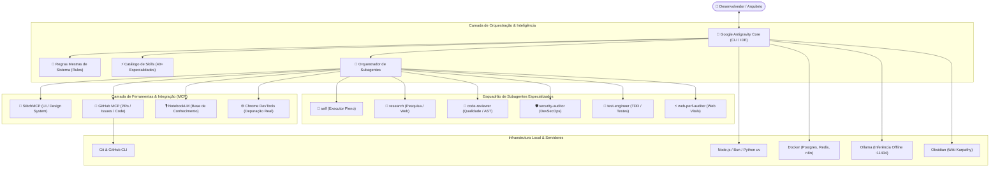

# 🏛️ Arquitetura do Sistema Antigravity Supreme

> Este documento detalha a arquitetura agêntica e operacional do **Antigravity**, descrevendo as camadas de orquestração, governança de subagentes, comunicação via Model Context Protocol (MCP) e protocolos de qualidade.

---

## 🏗️ 1. Visão Arquitetural em Camadas



---

## ⚙️ 2. Ciclo de Vida da Entrega: SDD + TDD

A arquitetura do Antigravity combate o *vibe coding* frágil através de um funil rigoroso de determinismo:

```text
  IDEIA BRUTA             ESPECIFICAÇÃO             PLANO ATÔMICO           EXECUÇÃO TDD          QUALITY GATE
┌──────────────┐         ┌──────────────┐          ┌──────────────┐        ┌─────────────┐       ┌────────────┐
│ /grill-me    │ ──────▶ │ /spec        │ ───────▶ │ /plan        │ ─────▶ │ /build      │ ────▶ │ /review    │
│ Sabatina     │         │ PRD & Schemas│          │ Ondas        │        │ Red->Green  │       │ 4 Eixos    │
└──────────────┘         └──────────────┘          └──────────────┘        └─────────────┘       └────────────┘
```

1. **Sabatina Socrática (`/grill-me`):** Trava Definition of Done, fronteiras e trade-offs.
2. **Especificação Técnica (`/spec`):** Define DTOs Zod/Pydantic, contratos de API e cenários Given/When/Then.
3. **Decomposição em Ondas (`/plan`):** Fatias sem dependência cruzada na mesma onda.
4. **Implementação Incremental (`/build`):** Ciclo TDD determinístico ticket por ticket.
5. **Quality Gate (`/review`):** Auditoria final com 4 eixos inegociáveis.

---

## ⚡ 3. Gestão de Memória: Ledger & Context Compaction

Em projetos extensos onde o histórico de mensagens excede a janela de contexto do modelo, o Antigravity preserva sua integridade através do **Ledger Persistente**:

* Localizado em `DOCUMENTACOES/planos_de_implementacao/LEDGER_[PROJETO].md`.
* Atualizado em modo append-only após cada tarefa ou revisão.
* Quando ocorre *context compaction*, o agente orquestrador lê o Ledger do disco e retoma a execução sem perda de contexto ou retrabalho.
